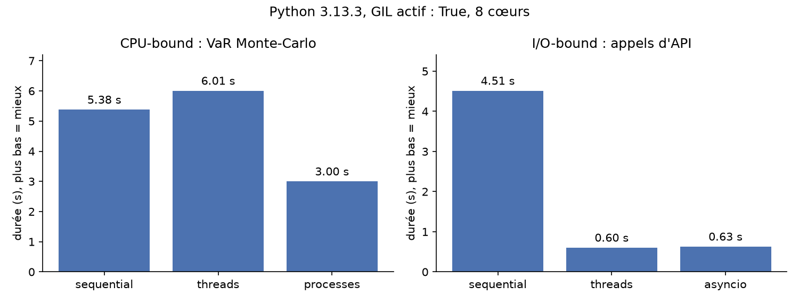

# Risk Concurrency Lab

Mesure, sur un petit moteur de risque financier, quelle méthode d'exécution Python est la plus rapide selon le type de travail : séquentiel, threads, processus ou asyncio.



## Pourquoi

En Python, le GIL ne laisse qu'un seul thread exécuter du code Python à la fois. Les threads accélèrent donc l'attente de données (réseau, disque), mais pas le calcul. Ce projet le mesure au lieu de le supposer, sur deux opérations typiques d'un moteur de risque :

- **Calcul (CPU-bound)** : VaR Monte-Carlo à 99 % d'un portefeuille de 1 M€ (EUR/USD, or, US30), en Python pur.
- **Attente (I/O-bound)** : récupération de cours auprès d'une API simulée (latence de 0,2 s, pannes simulées puis relancées).

## Résultats

Mesure de référence : Python 3.13, Windows, 8 cœurs, une exécution par méthode.

| Opération | Séquentiel | Threads | Processus | asyncio |
| --- | --- | --- | --- | --- |
| Calcul (4 × 500 000 scénarios) | 5,38 s | 6,01 s (×0,90) | **3,00 s (×1,79)** | – |
| Attente (20 cours) | 4,51 s | **0,60 s (×7,5)** | – | 0,63 s (×7,2) |

Toutes les méthodes trouvent exactement la même VaR : seule la durée change. Avec Python 3.14 sans GIL (Linux, 2 cœurs), les threads accélèrent enfin le calcul (×1,47).

**À retenir** : des processus pour le calcul, des threads ou asyncio pour l'attente.

## Fonctionnalités

- **Interface web** : 7 pages, responsive, mode nuit. On règle une mesure avec des curseurs, on lit la méthode recommandée et on exporte l'historique pour Excel.
- **API FastAPI** documentée sur `/docs` : chaque paramètre et chaque champ de réponse y est décrit.
- **Ligne de commande** : `python -m lab.benchmark` (toutes les options avec `--help`).
- **Décorateurs maison** : `@timed` (chronomètre), `@retry` (relance après une panne réseau), `@count_calls` (compteur sûr entre threads).

## Démarrage rapide

```bash
cd risk-concurrency-lab
python -m venv .venv
.venv\Scripts\activate              # macOS/Linux : source .venv/bin/activate
pip install -r requirements-dev.txt

pytest -q                           # 25 tests
uvicorn app.main:app --reload       # interface sur http://localhost:8000
python -m lab.benchmark --quick     # mesure rapide en ligne de commande
```

## API

| Route | Paramètres (valeur par défaut) |
| --- | --- |
| `GET /api/benchmark/cpu` | `paths` (100 000), `chunks` (4), `workers` (4), `level` (0.99), `repeat` (1) |
| `GET /api/benchmark/io` | `symbols` (10), `workers` (10), `latency` (0.2), `flaky` (true) |
| `GET /api/env` | aucun |
| `GET /api/reference` | aucun |

Chaque mesure renvoie les paramètres utilisés (`params`), la durée et l'accélération de chaque méthode (`results`), la plus rapide (`fastest`) et une lecture des chiffres (`interpretation`).

## Structure

```
risk-concurrency-lab/
├── lab/       moteur : charges de travail, 4 méthodes d'exécution, décorateurs, benchmark
├── app/       API FastAPI et interface web (HTML, CSS, JS sans dépendance)
├── tests/     25 tests pytest
└── results/   mesures de référence (JSON, Markdown, graphique)
```

## Déploiement

- **Vercel** : importer le dépôt et régler *Root Directory* sur `risk-concurrency-lab`. FastAPI est détecté automatiquement.
- **Docker** : `docker build -t rcl risk-concurrency-lab`, puis `docker run -p 7860:7860 rcl`.

Sur un hébergement gratuit (1 cœur), les mesures montrent le principe, pas la vraie accélération.

## Limites

- L'API de cotations est simulée et le modèle de rendements est volontairement simple : c'est un banc de mesure, pas un outil de production.
- Les durées dépendent de la machine et varient d'environ 15 % d'un essai à l'autre. L'option `repeat` mesure plusieurs fois et garde la médiane.

Documentation détaillée (GIL, décorateurs, choix des méthodes) : [risk-concurrency-lab/README.md](risk-concurrency-lab/README.md).
