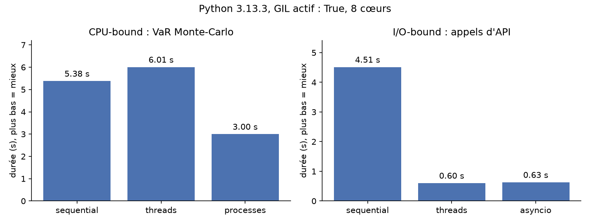

# Risk Concurrency Lab

Un petit moteur de risque financier qui **mesure** quand le GIL de Python bloque le parallélisme, et quand il ne gêne pas. Il compare l'exécution séquentielle, le multithreading, le multiprocessing et asyncio sur deux types de travail, et s'appuie sur des décorateurs maison (`@timed`, `@retry`, `@count_calls`).



## Résultats

Mesures faites avec `python -m lab.benchmark` sur une machine Linux à **2 cœurs**. Une seule exécution par stratégie : les ordres de grandeur comptent, pas les décimales.

**CPU-bound** : VaR Monte-Carlo à 99 % d'un portefeuille EUR/USD, or et US30, 4 × 500 000 scénarios, 4 workers.

| Stratégie | Python 3.13 avec GIL | Python 3.14t sans GIL |
| --- | --- | --- |
| Séquentiel | 1,47 s (×1,0) | 1,73 s (×1,0) |
| Threads | 1,74 s (**×0,85**) | 1,18 s (**×1,47**) |
| Processus | 0,90 s (**×1,65**) | 1,18 s (×1,46) |

Les trois stratégies trouvent exactement la même VaR (10 707,97 €), car chaque bloc de scénarios a sa propre graine aléatoire.

**I/O-bound** : 20 cotations récupérées auprès d'une API simulée (0,2 s de latence, 2 symboles qui échouent une fois), 10 workers.

| Stratégie | Durée | Accélération |
| --- | --- | --- |
| Séquentiel | 4,51 s | ×1,0 |
| Threads | 0,60 s | **×7,5** |
| asyncio | 0,61 s | **×7,4** |

### Ce que montrent ces chiffres

1. **Avec le GIL, les threads n'accélèrent pas le calcul.** Ils sont même un peu plus lents que le séquentiel (×0,85), à cause du temps passé à se passer le verrou.
2. **Les processus contournent le GIL.** Chaque processus a son propre interpréteur et son propre GIL : ×1,65 sur 2 cœurs. Le maximum théorique est ×2 ; le reste part dans le démarrage des processus et la sérialisation des résultats (pickle).
3. **Pour l'attente réseau, les threads suffisent.** Pendant `time.sleep` ou une vraie requête, le GIL est relâché : 10 threads attendent en même temps, d'où ×7,5. asyncio fait aussi bien avec **un seul thread**.
4. **Sans GIL (Python 3.14t), les threads calculent vraiment en parallèle** (×1,47), presque autant que les processus, sans leur coût de démarrage ni de sérialisation. Le séquentiel y est un peu plus lent (1,73 s contre 1,47 s) : la version sans GIL paie un surcoût sur chaque thread.
5. **Un piège découvert en mesurant** : sans GIL, des threads qui lisent les *mêmes* objets Python se disputent leurs compteurs de références. Avant de copier les paramètres du portefeuille localement dans chaque tâche (`simulate_losses`), les threads n'allaient qu'environ ×1,1 plus vite.

## Les concepts, simplement

### Le GIL

Le GIL (*Global Interpreter Lock*) est un verrou de CPython : **un seul thread exécute du bytecode Python à la fois**, même sur plusieurs cœurs. Il simplifie la gestion de la mémoire de l'interpréteur. Image : une cuisine avec plusieurs cuisiniers, mais un seul couteau.

Le GIL est relâché pendant les attentes d'entrées-sorties (réseau, disque, `time.sleep`) et dans certaines bibliothèques en C (NumPy, PyTorch). Depuis Python 3.13, une version expérimentale sans GIL existe (PEP 703) ; Python 3.14 la rend officiellement supportée, sans en faire la version par défaut.

### Choisir sa stratégie

| | Threads (`threading`) | Processus (`multiprocessing`) | `asyncio` |
| --- | --- | --- | --- |
| Mémoire | Partagée | Séparée (copie, pickle) | Partagée, un seul thread |
| GIL | Un seul pour tous | Un par processus | Un seul, mais un seul thread de toute façon |
| Idéal pour | Attente (API, fichiers, base de données) | Calcul pur | Beaucoup d'attentes simultanées |
| Coût | Faible ; attention aux accès concurrents | Démarrage et sérialisation | Tout le code doit être `async` |
| Dans ce projet | `run_threads` | `run_processes` | `run_asyncio` |

Même avec le GIL, **les threads ne sont pas automatiquement sûrs** : `compteur += 1` se fait en plusieurs étapes, et un autre thread peut s'intercaler. C'est pourquoi `count_calls` et la liste des symboles en échec sont protégés par un `threading.Lock`.

### Les décorateurs

Un décorateur est une fonction qui reçoit une fonction et renvoie une nouvelle fonction qui l'enveloppe. Écrire `@timed` au-dessus de `def f` revient à écrire `f = timed(f)`.

Dans `lab/decorators.py` :

- **`@timed`** mesure la durée de chaque appel. Il détecte si la fonction est `async` (`inspect.iscoroutinefunction`) et renvoie la bonne enveloppe. `functools.wraps` conserve le nom et la documentation de la fonction d'origine.
- **`@retry(times=3, delay=0.05, exceptions=(ConnectionError,))`** relance une fonction qui échoue, avec une attente qui double. C'est un décorateur **avec paramètres**, donc à trois niveaux : `retry(...)` renvoie le décorateur, qui renvoie l'enveloppe. Il ne relance que les erreurs réseau, jamais une erreur de code (testé dans `tests/test_decorators.py`). En version `async`, il attend avec `asyncio.sleep` pour ne pas bloquer la boucle d'événements.
- **`@count_calls`** garde un état (`fetch_quote.calls`) et reste juste même appelé par 8 threads à la fois.

L'ordre d'empilement compte. Sur `fetch_quote` :

```python
@count_calls      # 3. compte un appel par symbole demandé
@retry(times=3)   # 2. relance en cas de ConnectionError
@timed            # 1. mesure chaque tentative, y compris les échecs
def fetch_quote(symbol): ...
```

Les décorateurs s'appliquent de bas en haut : `fetch_quote = count_calls(retry(times=3)(timed(fetch_quote)))`.

## Structure

```
lab/decorators.py   les trois décorateurs
lab/workloads.py    VaR Monte-Carlo (CPU-bound) et API de cotations simulée (I/O-bound)
lab/runners.py      séquentiel, threads, processus, asyncio
lab/benchmark.py    mesures, interprétation, tableau Markdown, graphique et ligne de commande
app/main.py         API FastAPI pour lancer les mesures en ligne
app/schemas.py      format documenté des réponses de l'API (Pydantic)
app/static/         interface web : index.html, style.css, app.js (sans dépendance)
tests/              22 tests : décorateurs, stratégies, ligne de commande, API
```

## Lancer le projet

```bash
python -m venv .venv && source .venv/bin/activate   # Windows : .venv\Scripts\activate
pip install -r requirements-dev.txt   # site + tests + graphique

pytest -q                          # 22 tests
python -m lab.benchmark            # mesures complètes, écrit results/
uvicorn app.main:app --reload      # interface sur http://localhost:8000
```

Pour reproduire la colonne sans GIL : `uv python install 3.14t`, puis lancez `python3.14t -m lab.benchmark --no-plot` (`--no-plot` évite d'avoir à installer `matplotlib` dans cet environnement).

### L'interface web

Une page par rubrique, chacune avec sa propre adresse, accessibles depuis le menu (barre latérale sur ordinateur, bouton « Menu » sur téléphone) :

| Page | Adresse | Contenu |
| --- | --- | --- |
| Accueil | `/` | Présentation, accès rapide à chaque rubrique, les quatre méthodes |
| Calcul du risque | `/calcul` | Réglages, puis méthode recommandée, VaR, graphique des durées et lecture des résultats |
| Récupération des cours | `/cours` | Même chose pour des cours récupérés auprès d'un fournisseur lent |
| Historique | `/historique` | Vos mesures, exportables pour Excel (CSV) ou en sauvegarde |
| Résultats de référence | `/references` | Les mesures de `results/` |
| Suivi de l'activité | `/activite` | Demandes, relances automatiques et temps de réponse |
| Aide | `/aide` | Quelle méthode choisir, questions fréquentes |

L'interface parle en termes opérationnels plutôt que techniques :

| Dans l'interface | Dans le code |
| --- | --- |
| En série | séquentiel (`run_sequential`) |
| Multi-tâches | threads (`run_threads`) |
| Multi-moteurs | processus (`run_processes`) |
| En alternance | asyncio (`run_asyncio`) |
| Mode standard / sans verrou | GIL actif / désactivé |
| Relance automatique, demandes comptées, temps de réponse | `@retry`, `@count_calls`, `@timed` |

Un écart de moins de 15 % entre deux méthodes est traité comme une égalité : c'est la variation normale d'une mesure à l'autre sur un PC. Le réglage « Nombre d'essais » mesure chaque méthode plusieurs fois et garde la médiane.

Direction artistique : bleu nuit (structure), orange-jaune (actions et méthode recommandée), blanc (contenu), avec un mode nuit. Aucune bibliothèque externe ; la mise en page s'adapte du téléphone au grand écran.

### Options de la ligne de commande

`python -m lab.benchmark --help` liste toutes les options. Les principales :

| Option | Rôle | Défaut |
| --- | --- | --- |
| `--quick` | tailles réduites | non |
| `--only cpu` / `--only io` | ne lancer qu'une des deux mesures | les deux |
| `--paths`, `--chunks`, `--workers` | scénarios par bloc, nombre de blocs, workers (CPU) | 500 000, 4, 4 |
| `--level` | niveau de confiance de la VaR | 0.99 |
| `--repeat` | essais par stratégie, la durée retenue est la médiane | 1 (3 conseillé) |
| `--symbols`, `--io-workers`, `--latency` | cotations, appels simultanés, latence en s (I/O) | 20, 10, 0.2 |
| `--no-failures` | désactiver les pannes simulées | non |
| `--out`, `--no-plot` | dossier de sortie, pas de graphique | `results`, non |

Exemple : `python -m lab.benchmark --only cpu --paths 200000 --chunks 8 --workers 8`.

### Routes de l'API

| Route | Paramètres (défaut) | Rôle |
| --- | --- | --- |
| `/`, `/calcul`, `/cours`… | | Pages de l'interface web |
| `/api/benchmark/cpu` | `paths` (100 000), `chunks` (4), `workers` (4), `level` (0.99), `repeat` (1) | Mesure CPU-bound en direct |
| `/api/benchmark/io` | `symbols` (10), `workers` (10), `latency` (0.2), `flaky` (true) | Mesure I/O-bound en direct |
| `/api/env` | | Version de Python, GIL actif ou non, nombre de cœurs |
| `/api/decorators` | | Compteurs, relances et durées enregistrés par les décorateurs |
| `/api/reference` | | Mesures de référence de `results/` |
| `/health` | | Vérification pour l'hébergeur |
| `/docs` | | Documentation interactive : chaque paramètre et chaque champ de réponse y est décrit |

Chaque mesure renvoie le même format : `params` (les paramètres réellement utilisés), `results` (durée, accélération et VaR ou nombre de cotations par stratégie), `fastest` (la plus rapide) et `interpretation` (ce que montrent les chiffres). Un paramètre hors limites renvoie une erreur 422 qui explique le problème. Le serveur ne lance qu'une mesure à la fois pour que deux visiteurs ne faussent pas les durées l'un de l'autre.

```bash
curl "http://localhost:8000/api/benchmark/io?symbols=6&workers=6&latency=0.1"
```

### Déployer

**Vercel** (offre gratuite Hobby). Vercel détecte FastAPI tout seul : `app/main.py` définit `app`, et `requirements.txt` ne contient que ce dont le site a besoin. Depuis ce dossier :

```bash
npx vercel@latest login     # une seule fois, ouvre le navigateur
npx vercel@latest           # première fois : crée le projet, donne une URL d'aperçu
npx vercel@latest --prod    # met en ligne l'URL définitive
```

Ou par Git : poussez ce dossier sur GitHub, puis importez le dépôt sur vercel.com/new (si le dépôt contient un dossier parent, réglez *Root Directory* sur ce dossier). Chaque `git push` redéploie.

Ce qui change en ligne :

- **1 cœur** par fonction sur l'offre Hobby : les gains de calcul n'y apparaissent pas, les mesures montrent le principe. Les chiffres de référence restent ceux de `results/`.
- **Multi-moteurs** : si l'hébergement interdit de lancer des processus (pas de mémoire partagée `/dev/shm`, comme sur AWS Lambda), la mesure se fait sans eux et l'interface l'indique, au lieu d'échouer.
- **Suivi de l'activité** : les compteurs vivent en mémoire, par instance ; ils repartent de zéro quand Vercel arrête ou démarre une instance.
- **Durée maximale** d'une requête : 300 s sur Hobby, largement au-dessus des réglages maximum de l'interface.

**Docker** : le `Dockerfile` fonctionne tel quel sur Render, Railway ou Hugging Face Spaces (port 7860 par défaut, ou la variable `PORT` fournie par l'hébergeur). Un vrai serveur y donne accès à plusieurs cœurs et aux processus.

## Limites

- 2 cœurs seulement : avec plus de cœurs, l'écart entre threads et processus sur le calcul serait plus net.
- L'API de cotations est simulée (latence fixe), pour des mesures reproductibles sans dépendre du réseau.
- Par défaut, une seule exécution par mesure ; `--repeat 3` (ou « 3 essais » dans l'interface) mesure plusieurs fois et garde la médiane.
- La VaR est calculée sur des rendements gaussiens indépendants, un modèle volontairement simple.
